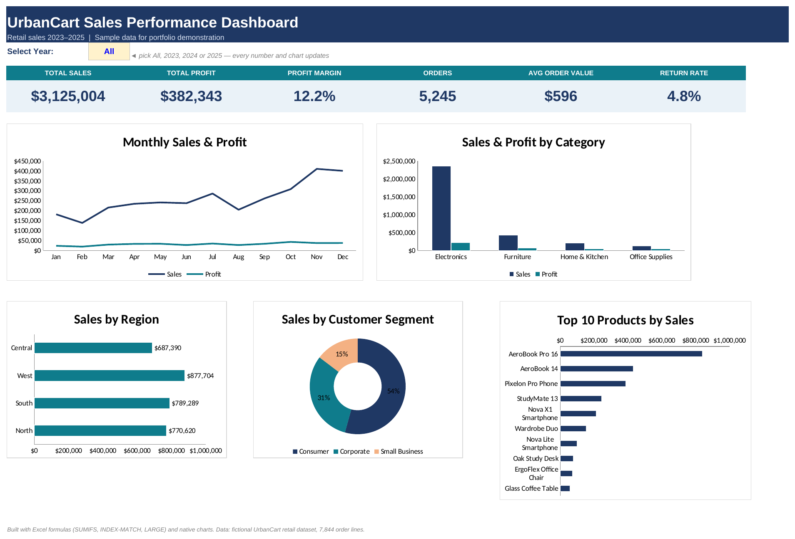
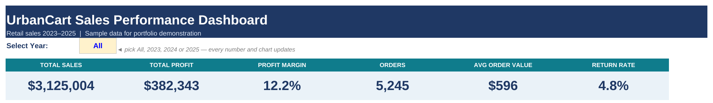

# UrbanCart Sales Performance Dashboard (Excel)

An interactive sales dashboard for **UrbanCart**, a fictional retail company, covering 2023–2025. A single year selector drives every KPI and chart.

## 🎯 Business problem

Management needed one place to answer: *How are sales and profit trending? Which categories, regions and customers drive the business? Where is margin being lost?* Previously this meant manually building pivot tables every month.

## 📁 Data

| Table | Rows | Description |
|-------|------|-------------|
| Orders | 7,844 | Order lines: date, product, customer, region, channel, quantity, discount, sales, cost, profit, returns |
| Products | 37 | 4 categories, 13 sub-categories, unit price and cost |
| Customers | 600 | Consumer, Corporate and Small Business segments |
| Regions | 8 | Cities across North, South, West and Central |
| Targets | 144 | Monthly sales targets by region |

Raw data: [`data/UrbanCart_Sales_Data_2023_2025.xlsx`](./data/UrbanCart_Sales_Data_2023_2025.xlsx)

## 🛠️ How it's built

- **Data sheet:** orders joined with product, customer and region details into one structured Excel table
- **Calculations sheet:** every figure is a live formula (`SUMIFS`, `COUNTIFS`, `INDEX-MATCH`, `LARGE`), driven by the year selector
- **Dashboard sheet:** 6 KPI cards, 5 native Excel charts and a dropdown filter (data validation)
- No hard-coded results: change the data and the dashboard updates

## 📊 KPIs tracked

Total Sales · Total Profit · Profit Margin · Orders · Average Order Value · Return Rate

## 🔄 Interactive year filter

## 💡 Key insights (2023–2025)

1. **Strong growth:** sales grew **11% in 2024** and **21% in 2025**, reaching $1.21M.
2. **Electronics drives revenue but not margin:** it brings in **75% of sales** but has the lowest margin (**9.5%**), versus **32%** for Office Supplies.
3. **Heavy discounts destroy profit:** orders at 0% discount earn a **19% margin**; at 20% discount margin turns **negative**, and at 30% it falls to **–15%**.
4. **Festive-season peak:** November and December alone generate **26% of annual sales**, so stock and staffing should be planned ahead.
5. **Returns hit high-value items:** Electronics (6.9%) and Furniture (6.0%) have roughly double the return rate of other categories.
6. **West is the top region** ($878K), while **Central** ($687K) has the most room to grow.

## ✅ Recommendations

- Cap discounts at 10–15% except for clearance stock
- Promote higher-margin Office Supplies and Home & Kitchen alongside Electronics
- Investigate product quality and descriptions for Electronics returns

## 📂 Files

- [`UrbanCart_Excel_Sales_Dashboard.xlsx`](./UrbanCart_Excel_Sales_Dashboard.xlsx): the dashboard (open in Excel and change the yellow year cell)
- [`data/`](./data): raw dataset

> Fictional sample data, created for portfolio demonstration.
