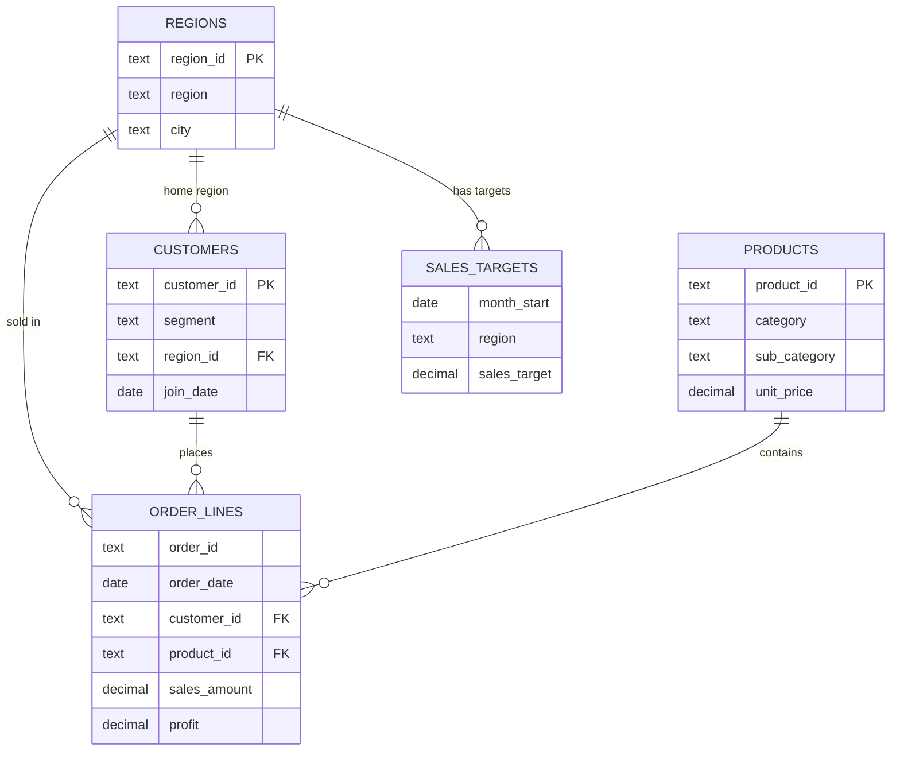

# UrbanCart Sales Analysis (SQL)

Business analysis of **UrbanCart**, a fictional retail company, using SQL on a 5-table relational database: 7,844 order lines, 600 customers and 30 products across 2023–2025.

**12 business questions answered** with joins, CTEs, window functions (`LAG`, `RANK`, running totals), `CASE` logic and conditional aggregation.


## 🗄️ Database design



| Table | Rows | Description |
|-------|------|-------------|
| `order_lines` | 7,844 | One row per product in an order: dates, ship mode, channel, quantity, discount, sales, cost, profit, returns |
| `customers` | 600 | Customer segment, home region and join date |
| `products` | 30 | 4 categories, 12 sub-categories, price and cost |
| `regions` | 8 | Cities in the North, South, West and Central regions |
| `sales_targets` | 144 | Monthly sales target per region |

## 📂 Files

- [`sql/01_schema.sql`](./sql/01_schema.sql): table definitions, keys and indexes
- [`sql/02_analysis_queries.sql`](./sql/02_analysis_queries.sql): all 12 analysis queries
- [`data/urbancart.db`](./data/urbancart.db): ready-to-query SQLite database
- [`data/`](./data): each table as a CSV, to load into MySQL, PostgreSQL or SQL Server

**Run it yourself:** open `data/urbancart.db` in [DB Browser for SQLite](https://sqlitebrowser.org/) (free) and paste any query.

---

## 🔍 Analysis

### Q1. Yearly performance & YoY growth

**Business question:** How did sales, profit and margin change each year?  
**SQL used:** Aggregation · LAG window function · CTE

<details>
<summary>Show query</summary>

```sql
WITH yearly AS (
    SELECT strftime('%Y', order_date)      AS year,
           COUNT(DISTINCT order_id)        AS orders,
           ROUND(SUM(sales_amount), 0)     AS sales,
           ROUND(SUM(profit), 0)           AS profit
    FROM order_lines
    GROUP BY year
)
SELECT year,
       orders,
       sales,
       profit,
       ROUND(100.0 * profit / sales, 1)                                    AS margin_pct,
       ROUND(100.0 * (sales - LAG(sales) OVER (ORDER BY year))
             / LAG(sales) OVER (ORDER BY year), 1)                         AS yoy_growth_pct
FROM yearly
ORDER BY year;
```
</details>

| year | orders | sales | profit | margin_pct | yoy_growth_pct |
|---|---|---|---|---|---|
| 2023 | 1,499 | 904,250 | 110,527 | 12.2 |  |
| 2024 | 1,742 | 1,007,043 | 122,225 | 12.1 | 11.4 |
| 2025 | 2,004 | 1,213,711 | 149,592 | 12.3 | 20.5 |

💡 **Insight:** Sales grew **11.4% in 2024** and **20.5% in 2025**, while margin held steady at about 12%. Growth came from volume, not from better pricing.

---

### Q2. Category & sub-category performance

**Business question:** Which product lines drive revenue, and which drive profit?  
**SQL used:** JOIN · GROUP BY · RANK window function

<details>
<summary>Show query</summary>

```sql
SELECT p.category,
       p.sub_category,
       ROUND(SUM(o.sales_amount), 0)                        AS sales,
       ROUND(SUM(o.profit), 0)                              AS profit,
       ROUND(100.0 * SUM(o.profit) / SUM(o.sales_amount), 1) AS margin_pct,
       RANK() OVER (ORDER BY SUM(o.profit) DESC)            AS profit_rank
FROM order_lines o
JOIN products p ON p.product_id = o.product_id
GROUP BY p.category, p.sub_category
ORDER BY profit DESC;
```
</details>

| category | sub_category | sales | profit | margin_pct | profit_rank |
|---|---|---|---|---|---|
| Electronics | Laptops | 1,514,201 | 154,813 | 10.2 | 1 |
| Electronics | Mobiles | 697,258 | 55,344 | 7.9 | 2 |
| Furniture | Storage | 192,711 | 38,878 | 20.2 | 3 |
| Home & Kitchen | Appliances | 128,562 | 28,282 | 22.0 | 4 |
| Furniture | Tables | 135,015 | 18,181 | 13.5 | 5 |
| Office Supplies | Art & Stationery | 50,226 | 17,240 | 34.3 | 6 |
| Office Supplies | Paper | 53,407 | 15,550 | 29.1 | 7 |
| Furniture | Chairs | 98,750 | 15,379 | 15.6 | 8 |
| Electronics | Accessories | 143,751 | 12,903 | 9.0 | 9 |
| Office Supplies | Binders | 29,831 | 9,861 | 33.1 | 10 |
| Home & Kitchen | Cookware | 54,595 | 8,822 | 16.2 | 11 |
| Home & Kitchen | Decor | 26,695 | 7,090 | 26.6 | 12 |

💡 **Insight:** **Laptops alone earn 40% of all profit**, but Electronics sub-categories have the lowest margins (8–10%). Office Supplies sub-categories earn **29–34% margins** on small volumes.

---

### Q3. Top 10 products by profit

**Business question:** Which individual products earn the most?  
**SQL used:** JOIN · ORDER BY · LIMIT

<details>
<summary>Show query</summary>

```sql
SELECT p.product_name,
       p.category,
       SUM(o.quantity)                                      AS units_sold,
       ROUND(SUM(o.sales_amount), 0)                        AS sales,
       ROUND(SUM(o.profit), 0)                              AS profit,
       ROUND(100.0 * SUM(o.profit) / SUM(o.sales_amount), 1) AS margin_pct
FROM order_lines o
JOIN products p ON p.product_id = o.product_id
GROUP BY p.product_name, p.category
ORDER BY profit DESC
LIMIT 10;
```
</details>

| product_name | category | units_sold | sales | profit | margin_pct |
|---|---|---|---|---|---|
| AeroBook Pro 16 | Electronics | 615 | 838,765 | 95,403 | 11.4 |
| Wardrobe Duo | Furniture | 361 | 154,201 | 30,970 | 20.1 |
| AeroBook 14 | Electronics | 519 | 430,801 | 30,626 | 7.1 |
| StudyMate 13 | Electronics | 484 | 244,634 | 28,785 | 11.8 |
| Pixelon Pro Phone | Electronics | 564 | 387,158 | 27,033 | 7.0 |
| Nova X1 Smartphone | Electronics | 578 | 211,769 | 23,567 | 11.1 |
| Coffee Maker | Home & Kitchen | 494 | 40,175 | 11,350 | 28.3 |
| A4 Copy Paper (Box) | Office Supplies | 1,342 | 39,627 | 10,989 | 27.7 |
| Desk Organizer | Office Supplies | 1,370 | 30,227 | 10,650 | 35.2 |
| ErgoFlex Office Chair | Furniture | 338 | 71,734 | 10,634 | 14.8 |

💡 **Insight:** Seven of the top 10 profit-makers are big-ticket items. **Desk Organizer, Coffee Maker and A4 Paper** make the list on margins of 28–35%: small items, but steady earners.

---

### Q4. Regional sales vs target (2025)

**Business question:** Which regions hit their sales targets in 2025?  
**SQL used:** CTEs · multi-table JOIN · CASE

<details>
<summary>Show query</summary>

```sql
WITH actuals AS (
    SELECT r.region,
           SUM(o.sales_amount) AS actual_sales
    FROM order_lines o
    JOIN regions r ON r.region_id = o.region_id
    WHERE o.order_date BETWEEN '2025-01-01' AND '2025-12-31'
    GROUP BY r.region
),
targets AS (
    SELECT region, SUM(sales_target) AS target_sales
    FROM sales_targets
    WHERE month_start BETWEEN '2025-01-01' AND '2025-12-31'
    GROUP BY region
)
SELECT a.region,
       ROUND(a.actual_sales, 0)                              AS actual_sales,
       ROUND(t.target_sales, 0)                              AS target_sales,
       ROUND(100.0 * a.actual_sales / t.target_sales, 1)     AS achievement_pct,
       CASE WHEN a.actual_sales >= t.target_sales
            THEN 'Target met' ELSE 'Below target' END        AS status
FROM actuals a
JOIN targets t ON t.region = a.region
ORDER BY achievement_pct DESC;
```
</details>

| region | actual_sales | target_sales | achievement_pct | status |
|---|---|---|---|---|
| West | 326,341 | 319,700 | 102.1 | Target met |
| South | 284,779 | 280,700 | 101.5 | Target met |
| North | 340,897 | 348,000 | 98.0 | Below target |
| Central | 261,694 | 269,300 | 97.2 | Below target |

💡 **Insight:** **West and South beat their 2025 targets**; North and Central fell 2–3% short. Central is both the smallest region and the furthest behind target.

---

### Q5. Customer segment analysis

**Business question:** How do Consumer, Corporate and Small Business customers compare?  
**SQL used:** COUNT DISTINCT · derived metrics

<details>
<summary>Show query</summary>

```sql
SELECT c.segment,
       COUNT(DISTINCT c.customer_id)                                       AS customers,
       COUNT(DISTINCT o.order_id)                                          AS orders,
       ROUND(SUM(o.sales_amount), 0)                                       AS sales,
       ROUND(SUM(o.sales_amount) / COUNT(DISTINCT o.order_id), 0)          AS avg_order_value,
       ROUND(SUM(o.sales_amount) / COUNT(DISTINCT c.customer_id), 0)       AS sales_per_customer
FROM order_lines o
JOIN customers c ON c.customer_id = o.customer_id
GROUP BY c.segment
ORDER BY sales DESC;
```
</details>

| segment | customers | orders | sales | avg_order_value | sales_per_customer |
|---|---|---|---|---|---|
| Consumer | 339 | 2,924 | 1,696,695 | 580 | 5,005 |
| Corporate | 171 | 1,610 | 970,367 | 603 | 5,675 |
| Small Business | 82 | 711 | 457,942 | 644 | 5,585 |

💡 **Insight:** Consumers bring the most revenue (54%), but **Small Business customers spend the most per order ($644 vs $580)**, making them a valuable segment to grow.

---

### Q6. Top 10 customers by lifetime value

**Business question:** Who are the most valuable customers?  
**SQL used:** Aggregation · MIN/MAX dates · LIMIT

<details>
<summary>Show query</summary>

```sql
SELECT c.customer_id,
       c.customer_name,
       c.segment,
       COUNT(DISTINCT o.order_id)        AS orders,
       ROUND(SUM(o.sales_amount), 0)     AS lifetime_sales,
       MIN(o.order_date)                 AS first_order,
       MAX(o.order_date)                 AS last_order
FROM order_lines o
JOIN customers c ON c.customer_id = o.customer_id
GROUP BY c.customer_id, c.customer_name, c.segment
ORDER BY lifetime_sales DESC
LIMIT 10;
```
</details>

| customer_id | customer_name | segment | orders | lifetime_sales | first_order | last_order |
|---|---|---|---|---|---|---|
| C0216 | Arjun Miller | Consumer | 12 | 24,710 | 2023-10-27 | 2025-10-29 |
| C0024 | Noah Kim | Consumer | 52 | 24,385 | 2023-01-01 | 2025-03-12 |
| C0086 | David Clark | Consumer | 24 | 23,962 | 2023-02-25 | 2025-12-05 |
| C0485 | Brian Brown | Corporate | 25 | 23,755 | 2023-02-16 | 2025-05-04 |
| C0046 | Fatima Young | Consumer | 18 | 23,140 | 2023-03-08 | 2025-11-14 |
| C0183 | Fatima Miller | Consumer | 14 | 22,208 | 2023-12-10 | 2025-12-16 |
| C0567 | Michael Lewis | Corporate | 37 | 20,361 | 2023-01-07 | 2025-03-01 |
| C0177 | Grace Clark | Small Business | 22 | 19,599 | 2023-02-01 | 2025-10-15 |
| C0508 | Michael Wright | Consumer | 23 | 19,074 | 2023-03-08 | 2025-09-16 |
| C0514 | Chris Lewis | Consumer | 29 | 18,911 | 2023-01-17 | 2025-11-21 |

💡 **Insight:** The top customer placed just 12 orders, while #2 placed 52. High-value customers come from both **big one-off purchases and loyal frequent buyers**, which call for different retention strategies.

---

### Q7. Impact of discounts on profit

**Business question:** Are discounts helping or hurting profitability?  
**SQL used:** CASE bucketing · conditional aggregation

<details>
<summary>Show query</summary>

```sql
SELECT CASE
           WHEN discount_pct = 0     THEN '0% (no discount)'
           WHEN discount_pct <= 0.10 THEN '1-10%'
           WHEN discount_pct <= 0.15 THEN '11-15%'
           ELSE '16%+'
       END                                                  AS discount_band,
       COUNT(*)                                             AS order_lines,
       ROUND(SUM(sales_amount), 0)                          AS sales,
       ROUND(SUM(profit), 0)                                AS profit,
       ROUND(100.0 * SUM(profit) / SUM(sales_amount), 1)    AS margin_pct,
       SUM(CASE WHEN profit < 0 THEN 1 ELSE 0 END)          AS loss_making_lines
FROM order_lines
GROUP BY discount_band
ORDER BY MIN(discount_pct);
```
</details>

| discount_band | order_lines | sales | profit | margin_pct | loss_making_lines |
|---|---|---|---|---|---|
| 0% (no discount) | 3,122 | 1,298,171 | 251,521 | 19.4 | 0 |
| 1-10% | 2,321 | 930,823 | 121,532 | 13.1 | 0 |
| 11-15% | 1,445 | 566,811 | 28,738 | 5.1 | 220 |
| 16%+ | 956 | 329,199 | -19,447 | -5.9 | 378 |

💡 **Insight:** Clear evidence that **heavy discounts destroy profit**: margin falls from 19.4% at no discount to **–5.9% at 16%+**, with 378 loss-making order lines.

---

### Q8. Return rate by category

**Business question:** Which categories have the most returns, and how much revenue is at risk?  
**SQL used:** Conditional aggregation · percentages

<details>
<summary>Show query</summary>

```sql
SELECT p.category,
       COUNT(*)                                                             AS order_lines,
       SUM(CASE WHEN o.returned = 'Yes' THEN 1 ELSE 0 END)                  AS returned_lines,
       ROUND(100.0 * SUM(CASE WHEN o.returned = 'Yes' THEN 1 ELSE 0 END)
             / COUNT(*), 1)                                                 AS return_rate_pct,
       ROUND(SUM(CASE WHEN o.returned = 'Yes' THEN o.sales_amount ELSE 0 END), 0) AS returned_sales
FROM order_lines o
JOIN products p ON p.product_id = o.product_id
GROUP BY p.category
ORDER BY return_rate_pct DESC;
```
</details>

| category | order_lines | returned_lines | return_rate_pct | returned_sales |
|---|---|---|---|---|
| Electronics | 2,485 | 171 | 6.9 | 138,740 |
| Furniture | 905 | 54 | 6.0 | 24,409 |
| Office Supplies | 2,765 | 102 | 3.7 | 4,861 |
| Home & Kitchen | 1,689 | 53 | 3.1 | 5,702 |

💡 **Insight:** **Electronics returns put $139K of sales at risk**, more than all other categories combined. It's the obvious place to look at product quality and descriptions.

---

### Q9. Customer retention: repeat buyers

**Business question:** How many customers keep coming back across years?  
**SQL used:** Subquery · COUNT DISTINCT · HAVING-style logic

<details>
<summary>Show query</summary>

```sql
WITH customer_years AS (
    SELECT customer_id,
           COUNT(DISTINCT strftime('%Y', order_date)) AS active_years,
           COUNT(DISTINCT order_id)                   AS orders
    FROM order_lines
    GROUP BY customer_id
)
SELECT active_years,
       COUNT(*)                                              AS customers,
       ROUND(100.0 * COUNT(*) / SUM(COUNT(*)) OVER (), 1)    AS share_pct,
       ROUND(AVG(orders), 1)                                 AS avg_orders_per_customer
FROM customer_years
GROUP BY active_years
ORDER BY active_years;
```
</details>

| active_years | customers | share_pct | avg_orders_per_customer |
|---|---|---|---|
| 1 | 156 | 26.4 | 3.3 |
| 2 | 225 | 38.0 | 6.8 |
| 3 | 211 | 35.6 | 15.2 |

💡 **Insight:** **74% of customers bought in more than one year**, and 3-year customers place 15 orders on average versus 3 for one-time buyers. Retention is strong.

---

### Q10. Monthly sales with running total (2025)

**Business question:** How did 2025 build up month by month?  
**SQL used:** SUM() OVER running total · date functions

<details>
<summary>Show query</summary>

```sql
WITH monthly AS (
    SELECT strftime('%m', order_date)   AS month,
           ROUND(SUM(sales_amount), 0)  AS sales
    FROM order_lines
    WHERE order_date BETWEEN '2025-01-01' AND '2025-12-31'
    GROUP BY month
)
SELECT month,
       sales,
       SUM(sales) OVER (ORDER BY month)                         AS running_total,
       ROUND(100.0 * sales / SUM(sales) OVER (), 1)             AS share_of_year_pct
FROM monthly
ORDER BY month;
```
</details>

| month | sales | running_total | share_of_year_pct |
|---|---|---|---|
| 01 | 85,698 | 85,698 | 7.1 |
| 02 | 41,166 | 126,864 | 3.4 |
| 03 | 78,426 | 205,290 | 6.5 |
| 04 | 91,543 | 296,833 | 7.5 |
| 05 | 88,954 | 385,787 | 7.3 |
| 06 | 68,111 | 453,898 | 5.6 |
| 07 | 106,719 | 560,617 | 8.8 |
| 08 | 70,931 | 631,548 | 5.8 |
| 09 | 120,917 | 752,465 | 10.0 |
| 10 | 166,015 | 918,480 | 13.7 |
| 11 | 171,667 | 1,090,147 | 14.1 |
| 12 | 123,565 | 1,213,712 | 10.2 |

💡 **Insight:** **October–December brought 38% of 2025 sales**, with February the weakest month. Stock and marketing should be planned around the Q4 peak.

---

### Q11. Shipping performance

**Business question:** How fast does each ship mode deliver?  
**SQL used:** julianday() date difference · AVG / MAX

<details>
<summary>Show query</summary>

```sql
SELECT ship_mode,
       COUNT(DISTINCT order_id)                                        AS orders,
       ROUND(AVG(julianday(ship_date) - julianday(order_date)), 1)     AS avg_days_to_ship,
       MAX(julianday(ship_date) - julianday(order_date))               AS max_days_to_ship
FROM order_lines
GROUP BY ship_mode
ORDER BY avg_days_to_ship;
```
</details>

| ship_mode | orders | avg_days_to_ship | max_days_to_ship |
|---|---|---|---|
| Same Day | 522 | 0.5 | 1.0 |
| Express | 1,589 | 2.5 | 3.0 |
| Standard | 3,134 | 5.5 | 7.0 |

💡 **Insight:** Delivery promises are consistent: Same Day ships within 1 day, Express within 3, Standard within 7. **60% of orders use Standard shipping.**

---

### Q12. Sales channel mix by year

**Business question:** Is the business shifting online?  
**SQL used:** Pivot with CASE · conditional SUM

<details>
<summary>Show query</summary>

```sql
SELECT strftime('%Y', order_date)                                                   AS year,
       ROUND(SUM(CASE WHEN sales_channel = 'Online'   THEN sales_amount ELSE 0 END), 0) AS online_sales,
       ROUND(SUM(CASE WHEN sales_channel = 'In-Store' THEN sales_amount ELSE 0 END), 0) AS in_store_sales,
       ROUND(100.0 * SUM(CASE WHEN sales_channel = 'Online' THEN sales_amount ELSE 0 END)
             / SUM(sales_amount), 1)                                                   AS online_share_pct
FROM order_lines
GROUP BY year
ORDER BY year;
```
</details>

| year | online_sales | in_store_sales | online_share_pct |
|---|---|---|---|
| 2023 | 519,035 | 385,215 | 57.4 |
| 2024 | 586,638 | 420,405 | 58.3 |
| 2025 | 745,199 | 468,512 | 61.4 |

💡 **Insight:** The business is **steadily shifting online**: online share rose from 57.4% to 61.4% in two years.

---

## ✅ Recommendations

1. **Cap discounts at 10%.** Anything above 15% loses money on average.
2. **Grow higher-margin lines** (Office Supplies, Home & Kitchen, Storage) alongside Electronics.
3. **Reduce Electronics returns** with better product descriptions and quality checks.
4. **Target Small Business customers:** they have the highest order value and are the smallest segment.
5. **Plan for Q4:** stock, staffing and campaigns for October–December.
6. **Support North and Central** with regional campaigns to close the target gap.

> Fictional sample data, created for portfolio demonstration.
