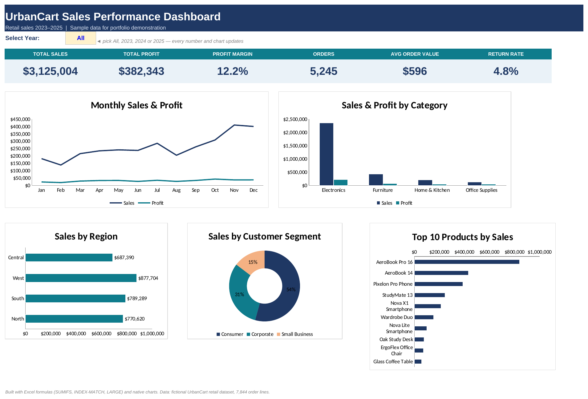

# 📊 Amit Uniyal — Data Analytics Portfolio

**Microsoft Certified Power BI Data Analyst (PL-300)** · Excel & Power BI Dashboard Specialist

I help businesses turn messy spreadsheets into clean, interactive dashboards and automated reports, so they spend less time preparing numbers and more time acting on them.

---

## 🗂️ Projects

| # | Project | Tool | What it shows |
|---|---------|------|---------------|
| 01 | [UrbanCart Sales Performance Dashboard](./01-excel-sales-dashboard) | Excel | KPI cards, year filter, 5 linked charts, formula-driven model |

*More projects (HR, Finance, Inventory and Power BI dashboards) coming soon.*

---

## ⭐ Featured: UrbanCart Sales Dashboard

An interactive Excel dashboard built on 7,800+ order lines: pick a year and every KPI and chart updates. [See the full project →](./01-excel-sales-dashboard)

---

## 🛠️ Skills

- **Power BI:** data modelling (star schema), DAX measures, interactive reports, drill-downs
- **Excel:** dashboards, advanced formulas (SUMIFS, INDEX-MATCH, XLOOKUP), pivot tables, charts
- **Power Query:** data cleaning, merging and transformation, refreshable reports
- **Business areas:** sales, finance, inventory, HR, audit and operations reporting

## 📜 Certifications

- Microsoft Certified: Power BI Data Analyst Associate (PL-300)
- Microsoft Certified: Azure Fundamentals

## 📬 Work with me

Need a dashboard or an automated report? Let's talk.

- **Fiverr:** [Hire me on Fiverr](https://www.fiverr.com/sellers/amituniyalau/)
- **GitHub:** [@amiuniyal](https://github.com/amiuniyal)

> All projects use fictional sample data created for demonstration. No client or employer data is used.
